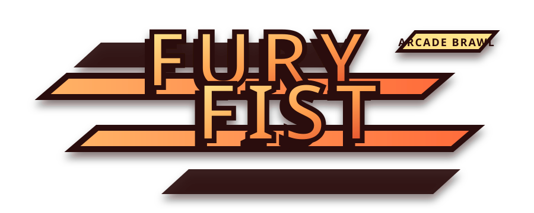
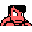
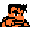
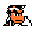
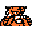

# Fury Fist / 热血飞拳

> A modern Godot 4.6 arcade brawler with pseudo-3D movement, fast combat, and bilingual presentation.
>
> 一款基于 Godot 4.6 开发的现代街机清版动作游戏，具备伪 3D 纵深移动、爽快战斗与中英双语界面。

## Overview / 项目概览

**Fury Fist / 热血飞拳** is a playable beat-'em-up project built in Godot 4.6. It features lane-based movement, combo-driven melee combat, grapples, throws, AI opponents, AI teammates, and a bilingual UI.

**Fury Fist / 热血飞拳** 是一个可直接运行的 Godot 4.6 清版动作项目，包含纵深移动、近战连招、抓取投技、AI 敌人、AI 队友以及中英双语界面。

## Screenshots / 画面预览

### Main Visual / 主界面预览

### Fighters / 角色预览

| Kunio | Riki | Mike | Ben | Toraji |
| --- | --- | --- | --- | --- |
|  |  |  |  |  |

## Highlights / 核心亮点

- **Godot 4.6 project** — ready to open and run
  **Godot 4.6 工程** —— 打开即可运行
- **5 playable fighters** — Kunio, Riki, Mike, Ben, Toraji
  **5 名可选角色** —— Kunio、Riki、Mike、Ben、Toraji
- **2 battle modes** — 4-Player Scuffle and 2v2 Team Battle
  **2 种战斗模式** —— 四人混战与 2v2 团队战
- **Fast combat systems** — punch, kick, guard, grapple, throw, lift, and ride
  **丰富战斗机制** —— 拳击、踢击、防御、抓取、投技、举起、骑乘
- **Presentation polish** — damage numbers, life bars, hit flash, screen shake, BGM, and SFX
  **表现强化** —— 伤害数字、血条、受击闪白、屏幕震动、BGM 与音效
- **Accessible settings** — bilingual UI, keyboard remapping, fullscreen/window mode toggle
  **设置完善** —— 中英双语、键位设置、全屏/窗口切换

## Game Modes / 游戏模式

| Mode / 模式 | Description / 说明 |
| --- | --- |
| **4-Player Scuffle** | 1 player versus 3 CPU opponents in a free-for-all battle. / 1 名玩家对战 3 名 CPU 敌人的混战模式。 |
| **2v2 Team Battle** | 1 player and 1 AI teammate versus 2 AI enemies. / 1 名玩家与 1 名 AI 队友对战 2 名 AI 敌人。 |

## Quick Start / 快速开始

1. Open the project with **Godot 4.6**.
   使用 **Godot 4.6** 打开本项目。
2. Run the main scene: `scenes/Main.tscn`
   运行主场景：`scenes/Main.tscn`
3. Default window size: `1280x720`
   默认窗口大小：`1280x720`
4. Stretch mode: `canvas_items`
   拉伸模式：`canvas_items`
5. Prebuilt exported binaries are not committed to this repository; export a local build if you need a standalone package.
   本仓库不提交预构建运行包；如需独立可执行版本，请在本地自行导出。

## Controls / 操作说明

### Battle / 战斗

| Action / 操作 | Key / 按键 |
| --- | --- |
| Move / 移动 | `W / A / S / D` |
| Punch / 拳击 | `J` |
| Kick / 踢击 | `K` |
| Guard / 防御 | `L` |
| Jump / 跳跃 | `Space` |
| Exit / 返回 | `Esc` |

### Menu / 菜单

| Action / 操作 | Key / 按键 |
| --- | --- |
| Navigate / 选择移动 | `W / S` or arrow keys / 或方向键 |
| Confirm / 确认 | `Enter` |
| Back / Cancel / 返回取消 | `Esc` |

## Project Structure / 项目结构

- `project.godot` — project settings / 项目配置
- `scenes/` — main flow and battle scenes / 主流程与战斗场景
- `scripts/` — gameplay, UI, config, and localization logic / 战斗、UI、配置与本地化逻辑
- `resources/data/` — runtime role, action, and stage data / 角色、动作与场景运行数据
- `assets/` — audio, sprites, and branding assets / 音频、图像素材与品牌资源
- `shaders/` — visual effect shaders / 视觉特效着色器
- `tools/` — maintainer-focused utilities / 面向维护者的工具脚本

## Current Status / 当前状态

### Implemented / 已实现

- Splash screen and animated main menu / 启动画面与动态主菜单
- Single battle flow and role selection / 单局战斗流程与角色选择
- 4-player scuffle mode / 四人混战模式
- 2v2 team battle mode / 2v2 团队对战模式
- Bilingual language switching / 中英双语切换
- Keyboard settings UI / 键位设置界面
- Window mode toggle and saved config / 窗口模式切换与配置保存
- Damage numbers, life bars, hit flash, screen shake / 伤害数字、血条、受击闪白、屏幕震动
- Audio playback and battle feedback / 音效播放与战斗反馈

### Planned / 计划中

- Network / LAN battle / 联机或局域网对战
- More complete upstream feature parity / 更完整的原项目功能补完
- Better public maintainer tooling for asset regeneration / 更完善的公开资源维护工具链

## Asset Notes / 资源说明

This repository is intended to be **playable as a Godot project out of the box**.

本仓库以 **作为 Godot 工程开箱即玩** 为目标。

The committed `assets/extracted/` and `resources/data/` contents are the runtime assets currently used by the game.

仓库中的 `assets/extracted/` 与 `resources/data/` 是当前版本实际运行所使用的资源。

Prebuilt export artifacts such as `output/windows_build/` are intentionally not tracked in this repository.

诸如 `output/windows_build/` 之类的预构建导出产物不会随本仓库一并提交。

`tools/build_port_assets.py` is considered a maintainer-oriented utility. Most players and regular contributors do not need to run it.

`tools/build_port_assets.py` 主要面向维护流程，一般玩家或普通修改者通常无需运行。

## Credits / 致谢

- Original project basis: **Punch And Kick**
- Godot port, packaging, and ongoing maintenance: **Fury Fist**
- 原始项目基础：**Punch And Kick**
- Godot 移植、整理与持续维护：**Fury Fist**

## License / 许可协议

Code in this repository is released under the MIT License. See [LICENSE](LICENSE).

本仓库代码基于 MIT License 发布，详见 [LICENSE](LICENSE)。

If you plan to redistribute the project publicly, please review the provenance and licensing status of any extracted upstream assets first.

如果你计划再次公开分发本项目，请先确认所使用提取素材的来源与授权状态。
